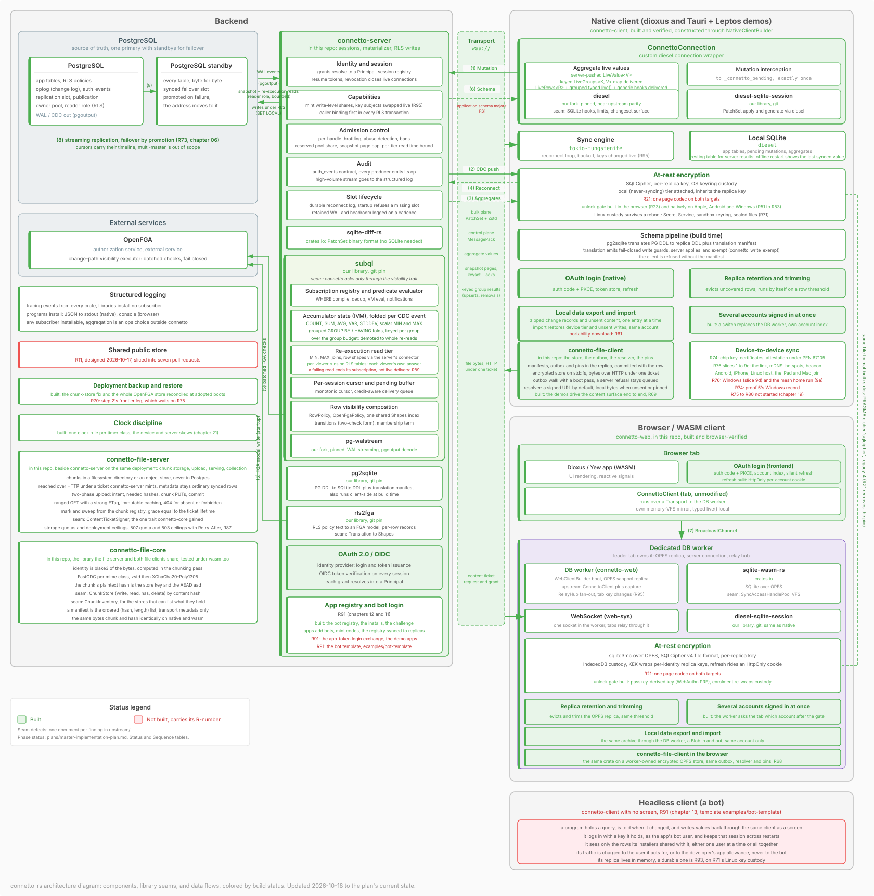

# connetto-rs

connetto is the core of a data-driven application, built once so that each application does not have to build it. A team writes its PostgreSQL schema with the row-level security policies that say who sees what, its UI, and whatever the service itself does. connetto takes care of everything between the database and the screen.

On the server, the database's logical replication stream is the source of every update. `subql`, the change data capture engine connetto hosts, matches each committed change against every open subscription in process, folds aggregates incrementally, and re-executes only the query shapes that need it, so a change costs the server one evaluation rather than a query per client. Every row is authorized on every path, by Postgres RLS on snapshots and writes, and on the change path by the same policies translated by `rls2fga` into an OpenFGA model, so a change reaches only the callers allowed to see the row as it was. Login is OAuth 2.0 and OIDC against any provider, and connetto mints the sessions, the grants, and the capabilities through which an application shares a row.

On the client, a SQLite replica on native and in the browser is read with Diesel and written optimistically. Every write applies on the server under the database's own policies and comes back to every subscribed device, every subscribed read stays live, and the replica is encrypted at rest and keeps working offline.

## What works today

| Area | Built |
|---|---|
| Sync loop | Optimistic writes applied under RLS, CDC through `subql`, live row subscriptions, reconnect with catch-up or resync |
| Aggregates | `COUNT`, `SUM`, `AVG`, variance and grouped folds per change, `MIN`, `MAX`, joins and rows re-executed per viewer |
| Identity | OAuth 2.0 and OIDC login, durable sessions a person lists and ends, grants, shareable capabilities, audit table, throttling and bans, revoked devices that wipe themselves, bots registered by one-time code and held to their declared tables |
| Authorization | RLS on snapshots and writes, the same policies as an OpenFGA model on the change path |
| Clients | One builder per platform, a native Diesel connection on desktop, Android and iOS, a browser client on a worker over OPFS, Dioxus and Yew hooks |
| At rest | SQLCipher and `sqlite3mc` with keyring or IndexedDB custody, passkey unlock in the browser and biometric or PIN unlock on Apple, Android and Windows, a device-private tier whose references SQLite enforces, retention, several accounts that keep the tables a deployment declares public in one store per device |
| Portability | Streamed device archives that restore the tier, unsent writes and unsent content |
| Files | Chunked, encrypted content with a file server and a client for both platforms, per-identity storage quotas and deployment storage and bandwidth ceilings answered with `Retry-After` |
| Schema | Postgres DDL translated to the replica at build time by `pg2sqlite`, with write guards, and a major per schema source, so one server runs per major and an updated app drains the writes and files the old build left to the major that captured them and migrates the device-private tier |
| Peers | Device certificates with hardware attestation, and a mutual TLS link between certified devices found over mDNS or a hotspot handed over by Bluetooth beacon or QR code, hosted on Android, iPhone and Linux and joined from those, the iPad and the Mac |
| Operations | `tracing` logs everywhere, Docker and headless Chrome suites, CI over eight workspaces with proofs on an Android emulator and an iOS simulator, both walking the Tauri demo |

## Where it stands

The plan in `plans/master-implementation-plan.md` tracks 103 phases, 88 done, 5 started and 10 not started, a phase built in parts counting once. The core is built and proven, and the app system's bot registry, registration and list cap are built with it. What remains is the last mile around it, plus the app system's bot login, runtime, template and demos, where a person mints a one-time code, a program registers with it, its public key and the tables and verbs it uses, an admin adds it to an owner, and Postgres holds it to that list (chapter 12), and queries an app keeps while closed with the wake that tells it they changed.

| Remaining | Phases |
|---|---|
| One page codec | R21 |
| Schema changes under running servers | R107 |
| Caller kinds as database roles | R108 |
| Demo gaps | R57 |
| Bot login, the standard ownership schema, the bot runtime and template, the demos for apps and bots | R99, R100, R103, R104 |
| Queries kept while an app is closed, and waking it | R101 |
| Device identity, missing only a Windows device's enrolment record | R74 |
| Device-to-device sync without a server | R76 to R80 |

A per-check consistency token, Zanzibar's zookie, is not supported and owned by no phase, since OpenFGA lists it as future work. A withdrawn permission therefore takes effect on the change path within the read cache lifetime, while writes and teardowns are refused at once (chapter 08).

## The design

`docs/architecture/README.md` indexes the chapters. `00-overview.md` is the entry point, `open-questions.md` the index of every numbered question and its decision. Every statement in a chapter carries a status marker, and a chapter outranks the plan on decisions while the plan outranks a chapter on phases.

The drawing below is the whole system coloured by build status. It is too dense to read inline, so open it in the browser and zoom.

## Layout

| Crate | Role |
|---|---|
| `connetto-core` | Wire protocol, framing, and the traits every side agrees on |
| `connetto-server` | Session manager, subscription materializer, auth stack, mutation handler, and the server builder that assembles them |
| `connetto-client` | Native Diesel connection, its builder, background sync, live queries, teardown, archives |
| `connetto-auth-session` | The platform browser tab a phone signs in through, returning to the app by redirect |
| `connetto-schema` | The build step translating a deployment's Postgres sources into the bundle client and server share |
| `connetto-web` | Browser platform on wasm32, the DB worker, the relay, storage and custody |
| `connetto-dioxus`, `connetto-yew` | Framework adapters exposing live queries as hooks |
| `connetto-file-core`, `connetto-file-server`, `connetto-file-client` | The file stack, which depends on connetto and never the reverse |
| `connetto-ca`, `connetto-app-attest` | The device certificate authority's offline ceremonies, and Apple App Attest behind device enrolment |
| `connetto-peer` | The mutual TLS link between certified devices |
| `connetto-exchange` | The device-to-device exchange of signed writer chains, without I/O |
| `connetto-peer-android`, `connetto-peer-apple` | The peer link's Android and Apple glue for permissions, hotspots, Bluetooth and discovery |
| `connetto-test-harness` | The in-process CDC loop and the browser stack runner behind the tests |

`examples/` holds one demo built on the shared `demo-support` crate and one deployment, in Dioxus for the web, desktop, Android and iOS, in Leptos for the browser and as the Tauri app's UI, and in Yew for the browser. It also holds the browser smoke suite and the passkey unlock proof.
