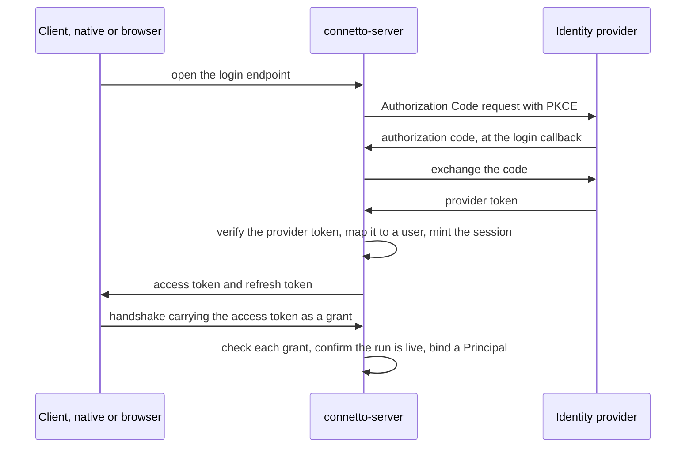

# 11: Authentication

This chapter covers authentication, from a user logging in to the server binding a verified identity onto a session. It owns the authentication boundary, the session credential and its lifetimes, how the clients acquire a credential, and what a deployment runs. Which rows an identity may read or write is [08-authorization.md](08-authorization.md), the session and identity and capability that ride the handshake are [12-identity-session-capability.md](12-identity-session-capability.md), the canonical model where the two chapters disagree, and what the local replica is named from and what it defends is [14-at-rest-encryption.md](14-at-rest-encryption.md).

## The authN and authZ boundary

Authentication answers who is this caller, and its output is [`connetto_core::auth::Principal`]. A caller that authenticated nothing holds an empty `Principal` rather than whoever it claimed to be. Authorization answers may this caller see or write this row, and it reads that `Principal`. Where the `Principal` carries an identity, [`connetto_server::PgSnapshotSource`] and [`connetto_server::PgWriteTarget`] bind its user id into `SELECT set_config('app.user_id', $1, true)`, so whatever this chapter resolves as the identity becomes the RLS principal directly. Where it carries none, that setting takes the absent marker [08-authorization.md](08-authorization.md) describes.

No constructor supplies a default for the identity story. A deployment states one, or the server refuses to start. The one stand-in that checks nothing and reads the subject straight out of the grant string, `TestGrantChecker` in [`test_support.rs`](../../crates/connetto-core/src/test_support.rs), lives behind a test-only feature no production build enables, beside the authorization one, `RosterAuth` in [roster.rs](../../crates/connetto-test-harness/src/roster.rs).

## Principles

1. **Identity is derived from a credential the server can verify, never from a client-supplied string.** The client id is a logging and correlation label, and the server keys nothing on it. One exception, and it is not the server. The browser relay hub keys each tab's durable write counter and its lock on the tab's client id, so there the client id is an identity. `tab_key` in [relay.rs](../../crates/connetto-web/src/relay.rs) computes a version-5 UUID of the raw string against a fixed namespace, and the write counter and the lock key derive from that value. A tab that cannot name itself uniquely would share another tab's write counter, which decides whether its writes count as already applied.
2. **connetto is the OAuth client, not the browser or the native app.** The backend runs the OAuth flow and mints its own session credential. Provider tokens never reach the frontend.
3. **Authentication gates sync, never local reads.** The local replica is readable and writable offline with no valid credential.
4. **Token expiry while offline is a designed state, not an error.** The app keeps working locally, and re-authentication resumes sync.
5. **Asymmetric algorithms only, with issuer and audience pinned.** The `none` algorithm is rejected, and a symmetric algorithm verified with a public key is rejected.
6. **The verification seam is pluggable and mirrors the authorization one.** A trait with a real implementation behind it and a test double that refuses whatever it was not told to accept, so tests and local loops need no live identity provider.

## Backend-For-Frontend

connetto uses the Backend-For-Frontend (BFF) topology, and at the provider boundary the claim is exact in the vocabulary of [RFC 10017, BCP 212](https://www.rfc-editor.org/rfc/rfc10017). connetto-server is registered with each identity provider as a confidential OAuth client and holds the provider client secret, and the frontend, native or browser, is not an OAuth client at all.

The token shape at the identity provider follows OAuth 2.0 Authorization Code with PKCE. Both OIDC ID tokens and JWT access tokens are accepted at the provider boundary, because a single-audience first-party deployment can pin the issuer and audience for either, and some providers (Google, for one) issue opaque access tokens whose only verifiable signed artifact is the ID token.

connetto retains the provider token in the auth store rather than discarding it, so an application that configured the right scopes can read a fresh token back through the lazy accessor and call the provider's own APIs. The lazy accessor refreshes inline against the provider when the stored one has expired, persists the rotated refresh token in the same store transaction, and serializes concurrent callers on that token row, so two of them cannot double-refresh and trip the provider's rotation-reuse defense. connetto runs no background refresh job.

Provider tokens never touch frontend JavaScript, which removes the cross-site-scripting exfiltration surface that storing them in the page creates, and every hard part stays on the backend. The frontend holds only a credential connetto can revoke by deleting a row.

## Identity resolution

### Providers

One struct implements the [`connetto_server::IdentityProvider`] trait per identity provider, Google, Microsoft, Apple, a generic OIDC fallback. Each struct carries its own confidential-client configuration, the client id, client secret, issuer, expected audience, tenant where relevant, and the OAuth scopes to request, and recognizes and verifies its own token shape. The provider structs quarantine the knowledge that differs per provider. Microsoft embeds the tenant in the issuer URL and ends it in `/v2.0`, so exact-string issuer matching is insufficient, whereas Google emits a fixed issuer.

The enabled providers are held in a runtime collection, [`connetto_server::ProviderRegistry`], indexed by issuer, with a matcher fallback for a provider that deliberately accepts a pattern of issuers, any-tenant Microsoft for one. Routing on the unverified issuer only selects a provider, and nothing in the token is trusted until the selected provider has verified the signature and re-confirmed the issuer and audience it expects. There is no blessed default provider, and a deployment composes the set it enables. A typed tuple of providers was rejected, because routing is a runtime match either way and every provider yields the same `AuthContext`. An unrecognised `CONNETTO_OIDC_<NAME>_KIND`, including an unset or miscapitalised one, is a startup error rather than a fall-through, because a silent fall-through would mint real signed tokens in which every user is the same dev identity.

### The auth store

The globally unique identifier for a user is the pair of the issuer claim and the subject claim, per OpenID Connect Core section 5.7. The subject alone is only locally unique within the issuer, and human-readable fields (email, phone, username) are never used as identity, because they change and are reused.

The identity mapping, connetto's own sessions and refresh tokens, and the user's retained provider tokens all live in one pluggable store, [`connetto_server::AuthStore`].

| | In-memory | Database |
|---|---|---|
| Symbol | [`connetto_server::InMemoryAuthStore`] | [`connetto_server::DbAuthStore`] |
| Identity resolution | Deterministic version-5 UUID over `(iss, sub)`, no lookup | A deployment-supplied [`connetto_server::IdentityResolver`] into the deployment's own users table, creating or linking the row so the `sessions.user_id` target exists |
| Durability | Ephemeral. A restart drops the sessions and tokens | Durable and replicated, and one human may hold several linked logins |
| Availability | Behind the `test-seams` feature, which no production build enables | The production build serves this variant alone, and the builder takes no store variant |

Each deadline is judged on the database's clock ([21-clocks.md](21-clocks.md)). connetto keeps every security decision, rotation, reuse-is-theft, liveness, and emits no schema.

Mapping runs once, at the login callback, when connetto mints the session, not on the handshake hot path. Account linking, attaching a second provider identity to an existing user, uses the standard safe procedure. The user must be authenticated on both accounts at link time, and identities are never linked on a shared email address alone.

### The deployment's tables

connetto emits no server DDL on any path a deployment runs. The one exception, `PgOplog::ensure_schema` in [oplog.rs](../../crates/connetto-server/src/oplog.rs), emits `CREATE TABLE IF NOT EXISTS` for the oplog table. It is opt-in, nothing in the server calls it and only a test does, so it is a scratch-database convenience, not a migration mechanism. [`connetto_server::ConnettoStoreSchema`] is the real contract, implementable by hand against whatever tables, column names, foreign keys, or indexes the deployment wants, and the `connetto_schema!` macro is a convenience default only. It expands to the `diesel::table!` blocks and the member impls, parameterized by the deployment's `Id` type, and names them all as one `ConnettoSchema`, whose one `Id` every member shares. [20-deployment.md](20-deployment.md) lists every table a deployment holds, and what the server does at startup when one is missing.

The writer table. `writer` is the primary key of `_connetto_writers`, a server-issued writer number the server mints on the handshake and stores, so a client that reconnects with the same number resumes from its stored frontier instead of replaying what it already settled. A device writer additionally has a unique `device_key` and survives its enrolment connection. `user_id` is nullable for anonymous writers. `frontier` is the highest settled sequence and `head` its chain hash. `secret_hash` is the SHA-256 of the 32-byte secret the client drew when it asked for a number. A handshake, a `RetireWriter` and an owned provenance name a number writer only with that secret, so a number the server issues again after a restore never binds the replica that held it before. A caller that asks for a number without a secret is issued it under one the server draws and keeps for that connection alone, so the number is never named again. [12-identity-session-capability.md#what-each-thing-keys](12-identity-session-capability.md#what-each-thing-keys) owns what the number keys.

The writer tables reference nothing. `user_id` is a plain column, not a foreign key into `connetto_sessions`. Every run has a writer, and only a login has a row in `connetto_sessions`, so a foreign key would refuse the first write by an anonymous caller. Widening `connetto_sessions` to hold an unidentified visit was considered and rejected. Its `user_id` and `current_refresh_hash` would both have to become nullable, which weakens the shape for every real login. A deployment that wants a hard link adds the constraint in its own migration, and an anonymous write stays exactly-once either way.

A number writer issued to a caller with no identity carries the run's durable handle in `session_id`, set only there, because numbers are sequential and only the run that drew the number confirms, prunes, retires, or names the writer as provenance. An identified caller's number writer leaves `session_id` empty and is matched by `user_id` alone.

### Multi-factor assurance

OIDC standardizes assurance signaling. A deployment can require step-up authentication with the `acr_values` and `max_age` request parameters and verify what the login actually reached through the `amr` and `acr` claims. connetto's provider configuration exposes an assurance requirement, [`connetto_server::AssuranceRequirement`], and the login callback rejects a provider token whose `amr` or `acr` does not meet the configured bar. That makes force-MFA a deployment setting rather than bespoke code.

## What the server answers about sessions

A session records how it began. `created_at` is stamped by the database's clock at the sign-in, `refreshed_at` at each refresh, absent until the first, `provider` the provider name the sign-in came through, and `issuer` the issuer its identity was verified from. A deployment may also declare a session descriptor, its own type mapped field by field onto extra columns through `connetto_schema!`'s `session_descriptor`, and the server then refuses to start without [`connetto_server::ServerBuilder::session_describer`]. That callback receives each sign-in's `LoginRequest`, the provider, the request's headers and the address the server saw, and returns the description the row keeps. The address itself is never stored, and the server describes the sign-in, never the client, because an intruder runs a client of their own choosing. The address reaches the callback only when the server is served with connect info, which `ServerBuilder::serve` does, and an embedder gets it through `into_make_service_with_connect_info`.

The application hears of each sign-in. [`connetto_server::ServerBuilder::on_sign_in`] receives [`connetto_server::SignInNotice::SignedIn`] with the new session's record after each sign-in, and [`connetto_server::SignInNotice`] with the session's record, the key and the device's descriptor after a key's first enrolment, never after a renewal. The application sends its own notice to the person. The hook fires whether or not the audit store is on, and each sign-in also leaves a `logged_in` row in `auth_events` naming its provider and issuer ([08-authorization.md](08-authorization.md)).

A person sees and ends their sessions. [`connetto_server::ServerHandle`] carries the calls an application makes from its own handlers, so connetto adds no endpoint. `verify_live` checks an access token's signature and confirms its session is live in the store, so a handler refuses an ended session at once instead of when its access token expires. `signed_in_places` lists a person's live sessions, oldest first, each with the device whose key last enrolled or renewed during it. `end_session` ends one of that person's sessions, and when a device enrolled during it the device's key is revoked first and the device is closed with `DeviceRevoked`. `end_other_sessions` and `end_all_sessions` end sessions only and revoke no key, so a sign-out everywhere wipes no device. A session of another person ends nothing, and each ended session closes its live connection and records its cause in `auth_events`.

Ending sessions answers what they left behind. `end_session`, `end_other_sessions` and `end_all_sessions` each answer an [`connetto_server::Ended`], naming the sessions it ended, the share keys those sessions minted with the key, the table and the row of each, and every installation the person owns with its app, since an installation records no session. The application withdraws a key by deleting its own relation row granting that key and removes an installation by deleting its row, at the person's choice, because a revoked session may have shared or installed something the owner meant. Every revocation, whatever its cause, also deletes the session's retained provider tokens in the same transaction, the only copy connetto can reach.

A session's writes are attributed to it, because a device key or a browser's number outlives any one login and a writer alone cannot tell the owner's writes from an intruder's on the same device. Each time an identified session binds a writer, at the handshake or a later device bind, the server records the pair with the writer's frontier plus one as the session's first sequence, once per pair, through [`connetto_server::ConnettoWriterSchema::bind_session`]. An anonymous run records none, since its number already carries its run handle. `ServerHandle::writes_of(session)` answers every writer the session bound, its device key when it is one, whether it retired, and the sequences the session settled under it. Recording costs one insert per bind and nothing per write. Every write transaction also binds its writer and sequence beside `app.user_id`, under the trait's `WRITER_SETTING` and `SEQ_SETTING`, `app.writer` and `app.writer_seq` by default, so a deployment stamps findable rows from those settings. Undoing the rows is the application's, and connetto never prunes the table.

A revoked device wipes itself. When a native client learns its own device key was revoked, by the `DeviceRevoked` close, by its own certificate in a revocation list, or by a renewal refused as revoked, the library wipes the device without the application acting, which covers a stolen phone running the real application. The wipe deletes the device key and its certificate, closes the client and stops it reconnecting, clears the stored credential, destroys the replica's key, deletes the replica, its tier and its content, clears the share keys, and runs the application's [`connetto_client::NativeDurable::with_device_wipe`] callback. [`connetto_client::ClientEvent::DeviceRevoked`] follows, naming any part that failed as a [`connetto_client::WipePart`]. A failed part leaves a marker beside the replica, and the next start completes the wipe before it signs in, refusing with `ClientError::WipePending` while a part still fails. Writes the server had not acknowledged are lost, so a device revoked by mistake loses them. An issuer's withdrawal deletes only the certificate and wipes nothing.

What stays out of reach. Data already synced to a device an attacker controls cannot be taken back, and an attacker's own client ignores the revocation. A browser enrols no device key, so its replica stays until it logs out with clear. An offline device wipes when it next learns of the revocation. An access token already minted stays signature-valid until its short lifetime ends for any handler that does not call `verify_live`. Share keys, installations and rows stay until the person and the application withdraw and undo them.

## The server verification seam

At the login callback, the `IdentityProvider` registry verifies the provider token and the mapper resolves the identity. At the handshake, the seam is [`connetto_core::HandshakeAuthority`]. It checks each grant on its own and the accepted subjects fold into a `Principal`, which may carry no identity at all. It is held as a runtime trait object, `Arc<dyn HandshakeAuthority<Id>>`, rather than a generic type parameter, because checking fires once per connection and a trait object keeps the server's public type signature stable.

[02-protocol.md](02-protocol.md#grants) says checking a grant is arithmetic with no database lookup, and the handshake also confirms the run is still live in the auth store. They do not conflict, because the lookup is not what recognises the grant. The signature already did that, and it is what makes an unrecognised string cost arithmetic and nothing more. What the store answers afterwards is a different question, whether the login this grant names has since been revoked, which is what makes revocation authoritative rather than bounded by the token's remaining lifetime.

The shape at `run_handshake`. Derive the run's handle first, then check every grant inside that logging context, fold what resolved into a `Principal`, and continue. No fatal reason names a refused grant, because nothing the handshake learns about a grant can end the connection, and a failed grant produces no field on the reply.

A capability grant is checked for signature, issuer, audience and expiry, and nothing else. There is no store call, because withdrawing a capability is deleting the relation that grants it and there is nothing to keep alive. Revoking a share therefore produces no grant refusal. The token still checks out, the subject still enters the `Principal`, and the rows simply stop matching the policy ([08-authorization.md](08-authorization.md)).

## The connetto session credential

connetto mints two tokens at login.

The **access token** is short-lived and asymmetrically signed. It carries only the identity (`user_id`) and the run's `sid`, and `tenant_id`, `roles`, and `claims` ride no token because nothing reads them. The handshake trusts the identity from the signature alone with no store round-trip, and separately checks that the session is still live. It is verified once at handshake, so a healthy long-lived connection is not dropped when the token expires mid-session. It is one grant in `Handshake.grants` ([02-protocol.md](02-protocol.md#grants)). The lifetime is short by default and server-configurable. Expiry allows [`connetto_core::clock::SERVER_SKEW`] of leeway, so a caller whose clock runs slightly fast is not refused at the second its token lapses.

The **refresh token** is longer-lived and stored server-side in the database store, not a separate store such as Redis, because the data is low-volume and read once per connection. It is shaped `<session>.<secret>`, and it rotates on every use. Each refresh mints a new refresh token and invalidates the old, and a reuse of an invalidated token is treated as theft. The refresh rotates connetto's own token only. It does not probe the provider, and that gap is [G6](../../plans/master-implementation-plan.md#g6).

The lifetime shape is a short access token plus a sliding refresh window under an absolute ceiling. [`connetto_server::AuthConfig`] prescribes it, with conservative, overridable defaults. [`connetto_server::RefreshLifetimes`] carries the window and the ceiling, the window measured from the session's last use and the ceiling from its creation, never extended. Each successful refresh through [`connetto_server::AuthService`] extends the window up to the ceiling, so a continuously active user stays refreshable until the ceiling and must log in again at it, which is the cost [G6](../../plans/master-implementation-plan.md#g6) records, together with a deactivated user keeping a session until one of the two lapses. The lifetime is set at the mint seam, so a deployment that wants per-user or per-device variation computes it there, and it is never requested by the client and never on the wire.

Revocation invalidates the session in the store, and because the handshake checks session liveness, a revoked session is refused on the next connection even while its access token is still time-valid, and a live connection is dropped by the server holding it as soon as that server sees the invalidation. A revocation the primary had not yet sent to a standby is lost if that standby is promoted, like any other write under asynchronous replication ([06-reconnect.md](06-reconnect.md#failover)). The liveness check consults the `revoked` flag and the absolute deadline, and a session past its idle window passes the handshake until its access token expires, which is the gap [G1](../../plans/master-implementation-plan.md#g1) records.

The server-issued resume credential stays distinct from the login grant. The identity credential is a signed grant, and the resume credential is the key to the operational session state subql already tracks, subscriptions, cursors, pending patches. The wire is [02-protocol.md](02-protocol.md#the-session-token), and the handle's persistence beside the replica is [12-identity-session-capability.md](12-identity-session-capability.md#what-each-thing-keys).

The token endpoints hand the client its `user_id` as the deployment's own typed id, serialized by serde and deserialized straight back into that type, never as an opaque string. Text survives only at the two edges that are inherently textual, the JWT `sub` claim and the `app.user_id` setting the write path binds for RLS, which is why the client can name a replica file from an id it has never rendered.

## Bot login

Planned in [R99](../../plans/master-implementation-plan.md#r99-bot-login-and-lifetime), a bot proves itself at connect with a signature over a server-issued challenge under its registered key, and never goes through a provider. [12-identity-session-capability.md#bots-lists-and-installations](12-identity-session-capability.md#bots-lists-and-installations) owns what a bot is, what the list caps it to, and how registration and installation work.

## Client acquisition

### Native

The native client uses Authorization Code with PKCE against connetto-server's login endpoint. On macOS, Windows and Linux the redirect is a loopback listener on `127.0.0.1` and the login opens in the user's own browser. On Android and iOS the redirect is a scheme the app claims, caught by a Custom Tab on Android and by an ephemeral `ASWebAuthenticationSession` on iOS through `connetto-auth-session`, which returns to the app. connetto's refresh token is stored in OS secure storage, behind the platform's user verification where it has one ([14-at-rest-encryption.md#key-custody](14-at-rest-encryption.md#key-custody)). The access token lives in process memory and is regenerated from the refresh token as needed.

### Browser and worker topology

The browser topology from [09-wasm.md](09-wasm.md) forces custody. The dedicated DB worker owns the single server connection and is the only context with OPFS access, but a worker cannot navigate, so interactive login must happen in a tab. The access token is held by the worker, never retained by the page, and the browser's refresh credential is a per-account `HttpOnly` cookie no script context can read.

Login is a redirect, or a popup carrying the redirect to avoid tearing down the leader tab and its worker, to connetto-server's login endpoint. The refresh credential arrives in the per-account `HttpOnly` cookie that the browser attaches to the auth endpoints' requests and no script can read, so a cold start or a leader failover silently refreshes and resumes with no user interaction and no durable credential in browser storage.

The cookie contract. The cookie name carries the `__Host-Http-` prefix, whose rules the browser itself enforces ([RFC 10017 section 6.1.3.2](https://www.rfc-editor.org/rfc/rfc10017#section-6.1.3.2)), and its `Max-Age` is the time left until the session lapses without a further refresh. The endpoints demand a required custom header on every cookie-contract request, the CSRF defence [RFC 10017 section 6.1.3.3.2](https://www.rfc-editor.org/rfc/rfc10017#section-6.1.3.3.2) places on the `POST`. The cookie renders `SameSite=Strict` unless the operator names `none` for a deployment whose app origin is a different site from its auth origin. A page embedded in another site is a third-party context where `None` without `Partitioned` does not ride, so an embedded deployment needs CHIPS, which no setting of `CONNETTO_AUTH_COOKIE_SAMESITE` substitutes for. The one listener grants CORS credentials only to the origins `CONNETTO_AUTH_CORS_ORIGINS` lists, so no unlisted page can spend the cookie. Telling development from deployment by the listener's bind address was rejected, since the default `127.0.0.1` bind behind a same-host proxy would read as development.

The enforced invariant that makes worker custody a real boundary. The worker's message protocol has no path that ever emits its access token back to a tab. With the refresh credential in an `HttpOnly` cookie it sits outside every script-reachable storage, so there is no durable credential to read, use off-device, or keep after the tab closes. That is the property [RFC 10017 sections 8.5 and 8.6](https://www.rfc-editor.org/rfc/rfc10017) tell an application it cannot obtain, not even with non-exportable `IndexedDB` keys. Page cross-site-scripting, while resident, can still drive the app as the user, which is unavoidable for any in-page attacker. Custody bounds the blast radius to the live session rather than a portable, persistent account takeover.

That invariant holds for the credentials and is qualified for the replica key, by [14-at-rest-encryption.md#browser-key-store](14-at-rest-encryption.md#browser-key-store). `PublicKeyCredential` is `[SecureContext, Exposed = Window]`, so the passkey derivation cannot happen in the worker and the key must cross from a tab. What crosses is a non-extractable `CryptoKey` rather than bytes, so script arriving after the unlock can ask the browser to use it while the page lives but cannot export it, persist it or take it off the device. The exception is narrow and real. The raw bytes exist in page script between the assertion resolving and the import, and script already resident at that instant obtains exportable material. The access token still never leaves the worker, and the browser holds no refresh token at all.

Because connetto is the OAuth client, no OAuth or OIDC crate needs to cross-compile to `wasm32-unknown-unknown`, and client-side OAuth and client-side ID-token verification do not arise.

## Offline-first and token expiry

The offline (no network) and unauthenticated (network present, no valid credential) states behave identically for local work, and in both the replica is fully usable and mutations queue in `_connetto_pending`.

On reconnect the client presents the refresh token to connetto-server's refresh endpoint before the handshake, then proceeds into the catchup or resync cases of [06-reconnect.md](06-reconnect.md), and pending mutations replay through the exactly-once machinery. This is the common case, because the access token is almost always stale after any real offline gap while the refresh token is still good.

The session's end and the replica's end are different events. Reaching the end of the refresh lifetime ends the session, and the replica stays on disk, encrypted ([14-at-rest-encryption.md#what-is-encrypted](14-at-rest-encryption.md#what-is-encrypted)), with its cursor and its queued mutations intact, and reopens on the next successful login. A device offline past its session length ends with unsynced mutations still queued, and they are still there when it re-authenticates, so a purge still blocks on unsynced data rather than discarding it. A provider failure of any kind changes nothing about local data, since no destructive action may hang off a signal that cannot distinguish revocation from a password change.

A plain logout does not purge. `NativeAuthenticator::logout` in [auth.rs](../../crates/connetto-client/src/auth.rs) revokes the session server-side and clears the refresh store only, and destroying a key record happens exclusively in `wipe_replica`. The acts that do destroy a replica are [14-at-rest-encryption.md#teardown](14-at-rest-encryption.md#teardown)'s.

Resuming a replica requires the same identity, and that is enforced by which replica file the client opens, named from the authenticated `user_id` before any transport opens ([14-at-rest-encryption.md#how-a-replica-is-named](14-at-rest-encryption.md#how-a-replica-is-named)). A re-authentication that yields a different `user_id` names a different file, and account linking is what lets the same human re-authenticate through a different provider and still resolve to the same `user_id`.

Each identity keeps its own replica, so a device may hold several at once and switching back resumes from that replica's persisted cursor instead of re-snapshotting. Destroying a replica is an explicit data wipe, never a side effect of another identity signing in.

A passkey verified by connetto-server as a login credential is rejected, not deferred. It would make the provider's decisions non-binding and connetto an identity authority. Biometric unlock of the locally stored credential is a different mechanism and is adopted, the gate [14-at-rest-encryption.md#the-gate-on-locally-stored-secrets](14-at-rest-encryption.md#the-gate-on-locally-stored-secrets) specifies. The server verifies nothing and sees nothing.

## Protocol impact

The wire changes the authentication boundary makes are recorded in [02-protocol.md](02-protocol.md), the grant list and the session token, and in [06-reconnect.md](06-reconnect.md), the `FullResyncReason` variant for an authorization change. `PROTOCOL_VERSION` stays frozen until the first release, with one deliberate bump then, per the version-bump decision in [02-protocol.md](02-protocol.md).

## Deployment shape

**Multi-provider and multi-tenant.** A deployment points connetto at its identity providers by composing the set of per-provider structs.

**One primary, and standbys for failover.** A standby promoted after a failure carries the auth store, so sessions, refresh tokens and revocations survive the promotion up to replication lag. [06-reconnect.md](06-reconnect.md#failover) holds the recipe and what clients experience. The access token's authenticity is checked locally with connetto's public key, which is not a secret. Multi-master is out of scope, because connetto rests on one ordered change log.

**Revocation.** The access-token lifetime is a re-auth cadence, not the revocation bound, and a deployment needing tighter reach shortens it. connetto adds no separate revocation channel.

**Audit.** Authentication events reuse the `auth_events` table from [08-authorization.md](08-authorization.md), with structured logging for the high-volume path, no new mechanism. [`connetto_server::AuthService`] logs a created session, a rotated refresh token, and a revocation, and the single point where every login, callback, token, and refresh failure renders its response logs the reason, which the wire deliberately withholds. This chapter's half of the table is how a login begins and the ways it ends.

**Throttling the endpoints.** A refresh names its session inside the token it presents, so a caller guessing a secret still says which session it is guessing at, and that is the key. Two counters, because the two attacks differ. Per session opposes guessing at one, and per account opposes working through several sessions of one person. The account behind a session is learned from the attempts this process has seen succeed, never by asking the store, since a lookup per guess is the cost the limit exists to avoid. Over the limit the endpoint answers `429` with `Retry-After` and never reaches the store. Only a credential failure counts, since a store that is down fails the honest attempts too and charging them would turn an outage into a lockout outliving it. A backend error and a resolver error spend nothing.

**The password surface is not connetto's.** Under the BFF flow the identity provider owns it, so connetto never sees a password or a caller-chosen account name and cannot meter attempts against one. What it can meter is what it can name, which is why the keys are the session and the account behind it rather than the login being attempted. Everything else at these endpoints (a guessed login code, a bad state value, an unparseable token) names nothing by construction, so its flood control belongs to the edge and connetto keeps those paths arithmetic before any store work.

## Dependencies

The BFF topology keeps the load-bearing dependency `openidconnect` on the backend. `jsonwebtoken` mints and verifies connetto's own access token in [`connetto_server::TokenAuthority`], and its `ring` dependency stays on the backend, never in a browser build. The native secure storage the refresh token and the per-replica key live in is [14-at-rest-encryption.md#key-custody](14-at-rest-encryption.md#key-custody)'s to describe. The browser links neither OAuth crate, and no upstream or fork work is warranted.
